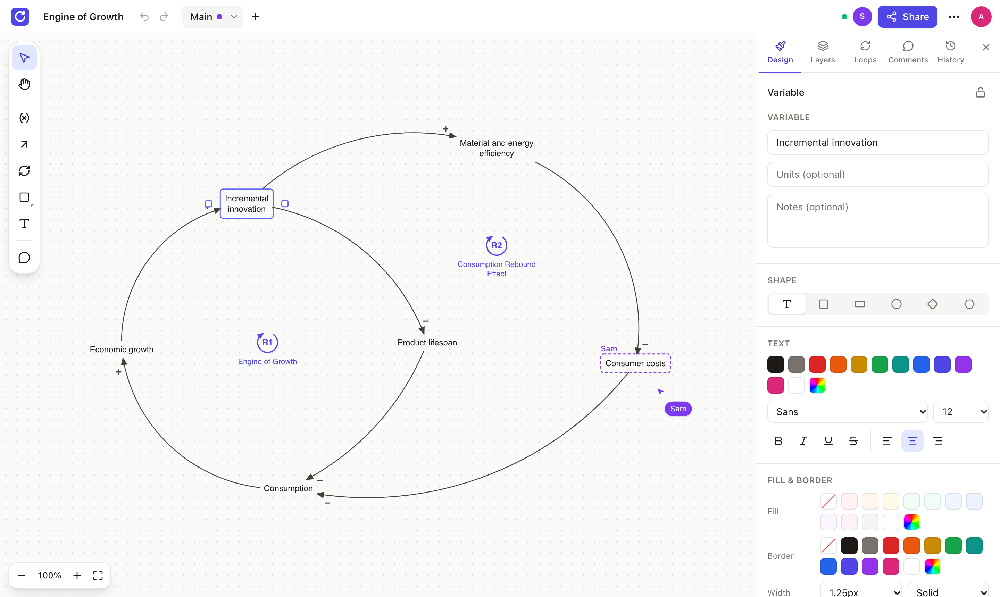

# Loopwise

**Draw causal loop diagrams together, in real time.**

Loopwise is a browser-based editor for causal loop diagrams (CLDs): the variables, cause-and-effect arrows and feedback loops used in systems thinking and system dynamics. Several people can work on the same diagram at once and see each other's cursors, selections and edits as they happen. Projects open and save as Vensim `.mdl` files, so a diagram can move between Loopwise and Vensim.



## Why Loopwise

- **Collaborative by default.** Everyone sees live cursors with names, everyone's selections and drags as they happen, and who is online. You can follow a teammate's view or leave threaded comments right on the diagram.
- **Start in one click.** _Start drawing_ needs no account. An account is only needed to share a project or open it on other devices, and your guest projects move over when you sign up. Invited collaborators can also join from a share link by just typing their name.
- **Made for CLDs.** Variables, curved causal links with + / – polarity and delay marks, R/B loop markers, shapes and text. Loops are found automatically and labelled reinforcing or balancing, and each marker stays tied to the loop it marks.
- **Works with Vensim.** Import `.mdl` files and export them back. Shapes, colours, fonts and loop markers survive the round trip, and parts that weren't edited stay byte-for-byte identical. Diagrams also export as PNG, SVG or vector PDF.
- **Never lose work.** A live history shows who changed what, and lets you undo single changes or restore a saved version.
- **Organised.** Many projects, several diagrams (views) per project, layers within a diagram, and example templates to start from.
- **Access control.** Owner, editor, commenter and viewer roles, invite links, and guests who can do only what their role allows.

Loopwise is open source and made by [AnemoLabs](https://anemolabs.de).

---

## Get started

### Run it with Docker

```bash
cp .env.example .env
# set BETTER_AUTH_SECRET in .env, e.g.:  openssl rand -base64 32
docker compose up -d --build
open http://localhost:8080
```

To serve on a real domain with automatic HTTPS, set `SITE_ADDRESS=your.domain`, `PUBLIC_URL=https://your.domain`, `HTTP_PORT=80` and `HTTPS_PORT=443` in `.env`. Google and GitHub sign-in are optional; see `.env.example`.

### Develop

Requirements: Node 24, pnpm (via `corepack enable`), Docker.

```bash
pnpm install
docker compose -f compose.dev.yaml up -d   # Postgres on localhost:5433
pnpm dev                                    # API on :3000, web on http://localhost:5173
```

Dev settings come from `.env.development`. Put personal overrides in `.env.local` (git-ignored).

| Command | What it does |
|---------|--------------|
| `pnpm test` | Unit and integration tests (needs the dev Postgres running) |
| `pnpm test:e2e` | Playwright end-to-end tests against `BASE_URL` (default: the dev server) |
| `pnpm lint` / `pnpm typecheck` / `pnpm format` | Code quality |
| `pnpm build` | Production builds of all packages |

To run the end-to-end tests against the Docker stack:

```bash
DISABLE_RATE_LIMIT=true BETTER_AUTH_SECRET=$(openssl rand -base64 32) docker compose up -d --build --wait
BASE_URL=http://localhost:8080 pnpm test:e2e
```

### Project layout

```
apps/
  server/     Fastify API + Better Auth + Hocuspocus (Yjs) + Drizzle/Postgres
  web/        React 19 + Vite + Tailwind editor and dashboard (served by Caddy in production)
packages/
  model/      Yjs document schema, editing commands, change history, loop analysis
  render/     Layout + deterministic SVG renderer (shared by canvas, exports and thumbnails)
  mdl/        Vensim .mdl parser/writer (+ fixtures)
  shared/     API types, roles
e2e/          Playwright tests (incl. multi-user collaboration)
docs/         Architecture plan (01–14), implementation notes (15), guest access (16–17)
```

Start with [`docs/15-implementation-notes.md`](docs/15-implementation-notes.md) for how it is built and why, and [`docs/07-mdl-format.md`](docs/07-mdl-format.md) for the Vensim format.

### Deploy (GitHub Actions)

`.github/workflows/deploy.yml` runs CI, builds arm64 images to `ghcr.io/anemocode/loopwise-{server,web}` and deploys `docker-compose.prod.yml` over SSH to `/opt/loopwise` (secrets: `DEPLOY_SSH_KEY`, `SERVER_HOST`, `SERVER_USER`).

1. Once, on the server: `cp /opt/loopwise/.env.example /opt/loopwise/.env` and fill it in (the first deploy copies the example there and then stops, asking for `.env`).
2. In Nginx Proxy Manager, add a proxy host for your domain → `http://<server>:18473` with **Websockets Support** on (needed for live collaboration) and an SSL certificate. `PUBLIC_URL` must be exactly that `https://` domain.
